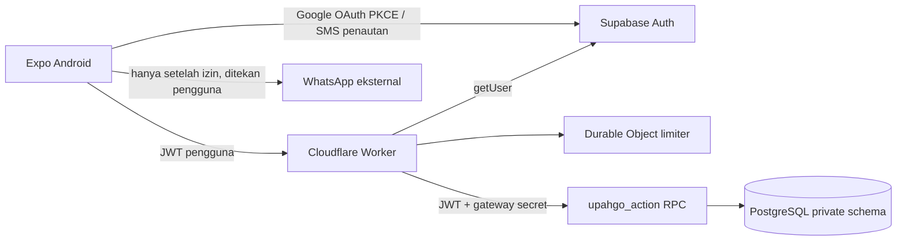

# Arsitektur Upahgo

Implementasi lokal 0.1, 17 November 2026. Android first. Belum di-deploy ke layanan produksi.

## Stack yang digunakan

React Native 0.88.1, Expo SDK 58, React 19.3, TypeScript 6, Expo Router. Material melalui React Native Paper, ikon Material Symbols SVG lokal, `react-native-maps` untuk Android. PostgreSQL/Supabase Auth untuk identity dan data; Cloudflare Worker + Durable Object untuk gateway dan pembatas. Versi tepat serta dependency transitive dikunci di `package-lock.json`. Node 22 digunakan untuk tooling.

Tidak ada server Next.js/admin, chat internal, payment gateway, push notification, analytics, upload, atau queue offline pada slice ini. Web merupakan preview aplikasi yang sama, dengan peta Leaflet/OSM beratribusi yang dimuat lazy (chunk sekitar 149 KB).

## Batas sistem

Cloudflare memvalidasi format/batas body, operasi allowlist, origin web tepat, rate limit IP dan actor, sesi melalui `getUser`. Tujuan upstream tetap Supabase yang dikonfigurasi, timeout dan redirect dibatasi. Database tetap otoritas actor, object, consent, state, dan nominal. Klien yang memanggil Supabase RPC langsung tidak memiliki gateway secret.

Auth OAuth/SMS tetap langsung ke Supabase, sehingga tidak tercakup limiter Worker. Konfigurasi provider dan kontrol penyalahgunaan Auth wajib terpisah. Lihat [setup layanan](docs/SERVICES.md).

## Data dan otorisasi

Migrasi berurutan tanggal 17 November: core, onboarding, location_reviews, discovery_design, work_details_suggestions, profile_photos. Terakhir `202611180001_profile_prices.sql` tanggal 18 November. Migrasi kedua memindahkan fungsi lama ke `upahgo_private.core_action` dan mencabut execute klien; wrapper publik tetap memvalidasi sesi, gateway, ACL dan input sebelum delegasi.

| Entitas | Tujuan |
| --- | --- |
| accounts, role_profiles | Progress onboarding/peran/area pencarian per akun; bio/tag per peran dipulihkan saat ganti peran |
| profiles, tags, areas | Identitas publik minimal, layanan, titik area umum |
| profile_prices | Harga awal per pekerjaan/sesi dan kesediaan nego per user/peran, terpisah dari upah kesepakatan |
| cities, account_locations, reviews | Polygon kota, lokasi pencarian yang dibulatkan/radius/freshness, penilaian peserta; privat dan RLS |
| presences | Opt-in visibilitas dengan batas waktu |
| contacts | Permintaan dan grant bilateral, hash nomor ketika setuju |
| blocks | Larangan melihat/menghubungi dua arah dari satu blokir |
| agreements | Tugas, total upah, jadwal, peran saat kesepakatan dibuat, status hasil/COD |
| notifications | Notifikasi di aplikasi; polling manual/focus, tanpa push |
| reports, deletion_requests | Catatan masuk untuk penanganan operator yang masih perlu dibuat |
| gateway_config, rate_buckets | Hash secret gateway dan pembatas khusus SQL |

Seluruh tabel berada di schema privat, RLS aktif tanpa policy/grant klien. RPC `SECURITY DEFINER` memakai `search_path=''`, actor dari `auth.uid()`, hak eksekusi authenticated, header gateway yang diverifikasi hash. Helper privat tidak executable oleh klien. Bukan model RLS `USING true` atau kepercayaan pada ownerId klien.

## Kontrak dan konsistensi

`shared/contracts.ts` memuat tipe serta nama operasi. `scripts/worker-contract.mjs` menghasilkan allowlist untuk Worker. Hasil live dan demo dipisahkan; demo tidak ditulis ke database. Identitas akun membatasi pembacaan kontak, notifikasi, dan kesepakatan. Pergantian akun membersihkan state UI; hasil refresh lama diabaikan dengan generation guard.

Transaksi RPC tunggal menangani notifikasi dan perubahan status sekaligus. Advisory lock actor membatasi write ganda; lock pasangan dan unique index mencegah dua grant aktif; row lock melindungi respons dan transisi kesepakatan. Satu kesepakatan aktif per kontak. Create kesepakatan ulang menghasilkan konflik; UI memperbarui data, tidak membuat retry otomatis atas write.

Tidak ada queue offline. Write gagal mempertahankan input dan menampilkan retry. Duplikasi state/izin dicegah server, bukan tombol saja. Discovery dibatasi 40 akun per query kota/radius/peran, aktivitas/notifikasi 100 terbaru. Filter server dijalankan sebelum limit 40, offset tervalidasi maksimal 1000; klien mengambil maksimal 1040 hasil lalu meminta pengguna mempersempit pencarian.

## Alur inti

1. Google login, bootstrap akun, pengenalan, pilih peran, lokasi/radius wajib, profil opsional/skip, Beranda. Lokasi pencarian terpisah dari marker profil publik; skip tidak membuat profil palsu; nomor disimpan terpisah di Auth, tidak di bio.
2. Pengguna sengaja mengaktifkan visibilitas. Dua mode pencarian memakai satu komponen peta, data pekerja atau pemberi kerja. Server membatasi hasil dengan kota/radius GPS; marker dibulatkan dan dapat bertumpuk, daftar selalu tersedia. Pan/zoom peta tidak memperluas query.
3. Permintaan kontak menyimpan persetujuan pengirim. Penerima harus menyetujui pembagian nomor. `approved_contact` memeriksa participant, status, expiry, block, akun aktif, dan kesamaan hash nomor. Nomor tidak berada pada daftar, profil, atau notifikasi.
4. WhatsApp dibuka manual ke `https://wa.me/<nomor tervalidasi>`. Tidak mengirim pesan otomatis. Nomor yang sudah disalin tidak bisa ditarik kembali.
5. Salah satu pihak mengusulkan tugas, jadwal/zona waktu, total upah COD. Pihak lain menerima. Pekerja mengajukan selesai, pemberi kerja mengonfirmasi hasil. Pekerja baru dapat mencatat uang diterima setelah hasil selesai. Aplikasi tidak mentransfer atau menjamin uang.

## Default implementasi untuk evaluasi

Bukan kebijakan bisnis yang telah dikonfirmasi: visibilitas 1 jam, permintaan pending 24 jam, grant diterima 30 hari, maksimal 5 tag, upah Rp1.000–Rp50.000.000, jadwal sampai 1 tahun ke depan. Batas ini harus ditinjau sebelum live. Tidak ada asumsi durasi 4 jam, deteksi bentrok durasi, pencocokan otomatis, atau pemeriksaan skill/identitas pekerja.

Satu peran aktif melalui Akun adalah rekomendasi yang diterapkan untuk evaluasi. Operasi onboarding/peran dan lokasi menyimpan progress server. Ganti peran memulihkan bio/tag dari role_profiles dan menghapus presence dalam transaksi yang sama. Profil minimum dan nomor terverifikasi tetap diperlukan untuk tindakan publik. AccountGate menunggu account bootstrap; penghapusan dapat diminta tanpa profil. Permintaan baru mengambil peran lawan sesuai mode pencarian. Peran kesepakatan lama disimpan snapshot dan tidak berubah bersama profil.

## Lingkungan dan pemulihan

Demo memori, PostgreSQL disposable untuk tes, Supabase staging/production terpisah bila disiapkan. Sesi native disimpan dalam SecureStore yang dipotong menjadi chunk dengan manifest commit terakhir; tidak di AsyncStorage. Sesi web preview di memori dengan popup OAuth; reload mengakhiri sesi.

Sebelum migrasi produksi: backup, uji restore, review grants, area, dan secret. Tidak ada down migration destruktif otomatis. Rollback aplikasi sebaiknya mempertahankan skema kompatibel; jangan drop schema yang sudah memiliki data. Rotasi gateway memerlukan koordinasi hash SQL/secret Worker; ketidakcocokan menolak akses.

## Koordinasi rilis onboarding

Urutan staging: migrasi 001–006 tanggal 17 November, `202611180001_profile_prices.sql`, provisioning kota/area yang ditinjau, Worker dengan allowlist terbaru, lalu klien. Klien GPS baru tidak kompatibel dengan klien manual lama; uji kompatibilitas staging, backup dan rollback sebelum deployment. Rilis harus dikoordinasikan dan diuji staging sebelum publikasi. Tidak ada migrasi remote atau deployment dilakukan. Pertahankan skema saat rollback; jangan menghapus tabel akun/profil yang sudah berisi data.

## GPS dan penilaian

Default implementasi untuk evaluasi: radius 1/3/5/10/20 km, awal 5 km; fix maksimum 5 menit, akurasi ≤1.000 m, toleransi masa depan 60 detik; kesegaran penemuan 30 menit. Server menentukan kota melalui polygon dari fix tervalidasi, tanpa pemilihan kota manual. Titik pencarian dibulatkan 3 desimal (sekitar 110 m), marker publik 2 desimal (sekitar 1 km), dengan pusat area sah bila pembulatan keluar polygon. Ini bukan jaminan anonimitas, identitas atau anti-pemalsuan GPS.

Lokasi ditolak, tidak akurat, kedaluwarsa atau di luar kota terlayani menutup penemuan/kontak baru; tidak ada fallback live ke demo. Akun yang sudah ada tetap dapat membuka Aktivitas, Akun dan bantuan. Pembaruan foreground dan saat aplikasi aktif kembali mempertahankan radius; tanpa watcher/service background. Login tidak mengaktifkan visibilitas. Logout mencoba menyembunyikan presence; jika jaringan gagal, kesegaran lokasi 30 menit atau expiry presence 1 jam membatasi sisa tampil.

Penilaian 1–5 integer, komentar opsional maksimal 300 karakter tanpa nomor/tautan: hanya peserta kesepakatan selesai, satu penilaian immutable per kesepakatan/pemberi ulasan. Server menentukan sasaran dan peran historis; agregat dipisah per peran. Pekerja dan pemberi kerja/tempat dapat dinilai. Penilaian, penyelesaian pekerjaan dan pengakuan uang COD tetap tindakan berbeda. Consent sebelum WhatsApp dan visibilitas opt-in tetap berlaku.

Fix tepat melewati Worker ke RPC untuk validasi, tanpa penyimpanan/log atau query geocoder. `shared/geo.ts` dan `shared/pekanbaru.json` dipakai demo; SQL tetap otoritas live. `expo-location` 58.0.22 (MIT), `leaflet` 1.9.4 (BSD-2-Clause), `@types/leaflet` 1.9.22 (dev) ditambahkan; versi dikunci lockfile. Penyedia tile menerima IP/koordinat tile, bukan fix GPS langsung. Native Google Maps key belum tersedia. Sumber/lisensi: [docs/GEO-DATA.md](docs/GEO-DATA.md).

## Katalog dan media privat

Migrasi 004 discovery_design, 005 work_details_suggestions dan 006 profile_photos melanjutkan 001–003, seluruhnya lokal. Katalog shared JSON/TypeScript adalah kontrak UI/Worker/SQL; allowlist Worker mencakup suggest_job, job_suggestions dan photo_access. Usulan privat pending tidak mengubah katalog aktif. State filter per akun/peran hanya di memori.

Foto melalui `/v1/photo` Worker ke Edge `supabase/functions/profile-photo/handler.ts`. Edge memvalidasi gateway dan getUser; service-role hanya Edge, tidak Worker/mobile. SQL photo_access memeriksa aktor, kota/radius dan blokir sebelum signed URL 60 detik. Pending hanya pemilik. Bucket profile-photos privat dengan RLS/grants; replacement RPC service-only mengunci kepemilikan/path dan mereset status pending. Detail/thumb JPEG dihasilkan ulang dengan ImageMagick WASM, EXIF/GPS dibuang. Native/web membaca bytes menjadi base64 di memori agar signed URL tidak diserahkan ke cache disk Image; ini bukan jaminan seluruh cache OS terhapus.

Penggantian/penghapusan lama masuk media_cleanup untuk retry; upload parsial/commit tak pasti membutuhkan orphan sweep operasional. Moderasi manual, retensi dan operator belum siap; rilis foto live tertahan. WASM server pinned/ignored sekitar 15 MB, bukan bundle mobile; photo:prepare menyalinnya sebelum tes/deploy Edge.

## Harga profil dan nego, 18 November 2026

Migrasi `202611180001_profile_prices.sql` dijalankan setelah seluruh 001–006 tanggal 17 November. Tabel privat `profile_prices` memakai kunci `(user_id, role)`, integer Rp1.000–Rp50.000.000 dan flag negotiable. Wrapper publik mendelegasikan gate existing melalui `photo_action`, mengambil actor dari `auth.uid()`, mempertahankan lock, gateway dan ACL. Field harga ditempelkan hanya pada hasil bootstrap pemilik, save_profile, profile dan discover yang sudah diotorisasi. Edit profil tetap mencabut presence; harga tidak dipublikasikan melewati gate tersebut.

Kontrak Profile/Person menambah priceAmount nullable dan priceNegotiable. Save lama tanpa field harga mempertahankan data; null + false menghapus harga aktif saja. Pergantian peran memulihkan harga dari baris peran, tanpa menulis ulang Agreement.wage. Demo menggunakan bentuk yang sama dalam memori.

Nego adalah langkah awal pembentukan kesepakatan existing, bukan jenis transaksi baru. Kontak accepted yang belum kedaluwarsa diperlukan untuk editor. Nominal/catatan hanya ada dalam state draft; URL membawa contactId dan intent. Tinjau usulan dilanjutkan ke tugas/jadwal dan review final sebelum create_agreement. Server tetap memeriksa peserta, izin kontak, batas upah serta konflik proposal; penerimaan pekerjaan dan COD tidak berubah.

Rollback klien dapat mempertahankan tabel/migrasi ini karena save lama tidak menghapus harga. Jangan membalik rename wrapper atau menghapus tabel berisi data otomatis; backup/restore dan kompatibilitas RPC harus diuji staging sebelum deployment. Belum ada migrasi remote.

